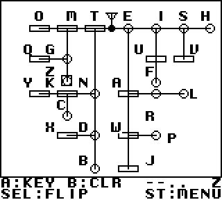

# Controls and emulator guide — Morse Boy v0.6.0

Use the emulator's ordinary Game Boy mappings. Keyboard/gamepad assignments
vary by emulator: map each named Game Boy button explicitly. A traditional
straight-key action means hold A for the tone and release A for silence.

## Navigation

- Splash: START opens the main menu; music continues through that transition.
- Main menu: UP/DOWN chooses DECODER, RECEIVE RX or TRANSMIT TX; A enters.
- RX menu: UP/DOWN chooses LEARN or PRACTICE; A enters; B or START returns
  to the main menu.
- TX menu: UP/DOWN chooses SPEED DRILL, WORD BANK or SCRATCH; A enters;
  B or START returns to the main menu.
- START returns directly to the main menu from activities. The old decoder
  five-press shortcut is no longer required. Release entry buttons before keying.

## Decoder

A is the Morse key: short holds give dots; longer holds give dashes. B clears
the current sequence. SELECT flips the chart. START exits with one press.
The footer shows the live Morse sequence and decoded letter. Timing is fixed,
not controlled by TX WPM; a sufficiently long idle period clears the sequence.
Consecutive dashes stop at `--- O`; four dots still produce H.
There is no software mute. Use physical volume or emulator audio controls.

## Receive RX — Learn and Practice

Learn's stage selector uses LEFT/UP to decrease and RIGHT/DOWN to increase
stages 1–13. A begins; B or START returns to the main menu. Every stage is
available immediately. Questions cover all letters introduced through the
selected stage; there is no automatic stage advancement or saved unlocking.

| Stage | New letters | Stage | New letters |
| --- | --- | --- | --- |
| 1 | E T | 8 | W B |
| 2 | A I | 9 | C Y |
| 3 | M N | 10 | L Q |
| 4 | S O | 11 | F P |
| 5 | H G | 12 | V X |
| 6 | U D | 13 | Z J |
| 7 | R K | | |

Practice uses A–Z and 0–9 immediately. Each question automatically plays Morse
at approximately 22 WPM. D-pad chooses an available grid answer; A confirms;
B replays; SELECT reveals a free pattern hint; START returns to the main menu.
The `?` placeholder hides the letter until feedback. New choices must finish
rendering and buttons must be released before the next answer is accepted.

A correct answer increases the streak. A mistake resets it and removes one
battery segment. There are three lives and no recovery. Brief feedback reveals
the answer and pattern, then the next question begins. At TRANSMISSION ENDED,
A retries the same mode/stage and START returns to the main menu. Best streak
is shared across RX modes for the running session and is lost on power-off.

## Shared TX controls

A is the straight key. LEFT/RIGHT changes requested WPM by one per press,
within 05–99; a fresh session starts at 15. TX modes share the session setting.
Changes during a partial character apply at the next character boundary.
The number is the requested setting, so it may briefly differ from active
character timing. Release A between elements; silence completes a letter.
Unsupported or overlong codes appear as `?`; valid mistakes are retained.
START exits and stops the tone, including while A is held.

### TX Speed — SPEED DRILL

Send the large target letter. SELECT toggles its Morse hint, hidden again
for each new target. Correct, wrong or invalid feedback is brief, then another
letter appears. There are no lives, scores or forced retries. B is unassigned.

### TX Words — WORD BANK

Send the displayed target or any other letters/digits. RECEIVED records what
you actually sent, including mistakes. Long pauses do not insert visible
spaces in this single-word exercise. Nothing automatically corrects, retries
or advances. B advances through the 64-word bank and clears the transcript,
including partial input. It wraps after the last entry. SELECT is unassigned.

Targets and received text use 16×16 characters. The received buffer holds
36 characters over four lines of nine. At BUFFER FULL it stops appending
safely; B clears and advances. The next target is revealed only when complete;
a brief blank transition is intentional.

### TX Scratch — SCRATCH

Transmit freely into 18 columns × 8 rows (144 characters). Actual seven-unit
word gaps insert spaces. Text wraps without scrolling; long words can split
at line ends. B clears the page and partial input; at FULL, further input does
not append until B clears. SELECT has no assigned action. No backspace,
manual-space control, targets or scores are provided.

## Verified EmuELEC / RetroArch / Gambatte remapping

The following game-specific procedure was verified by the developer:

1. Launch Morse Boy, then open **Quick Menu → Controls**.
2. Assign physical **R2 (Auto: 5)** as an additional **Game Boy A** input.
   Keep the original A mapping active.
3. **Auto: 7 is R1 / Fast Forward**; it is not R2. Do not assign or use
   fast-forward as the Morse key.
4. Choose **Save Game Remap File**. Do not save a core-wide or content-directory
   remap, which would affect other games.
5. Quit RetroArch to EmulationStation and relaunch Morse Boy. The game-specific
   remap was verified to persist through this sequence.

Verified remap directory: `/storage/.config/retroarch/config/remaps`.
Device model, exact software versions and remap filename remain undocumented.
Other devices and mappings are pending verification. This mapping test is
separate from certification of timing or audio on a particular handheld.

## Physical Morse key — conceptual compatibility

A possible route is **straight key → suitable USB keyboard/gamepad interface
→ emulator input mapping → Game Boy A**. The interface must present a held
button while the key is closed and release it when open. No particular key,
USB interface, wiring or adapter has been tested for this package. Arbitrary
keys/paddles are not claimed to be plug-and-play; paddles require appropriate
keyer/interface behavior, and the game has no iambic-keyer mode.

## Complete 64-word bank

B advances in this order, wrapping from MARCONI to KEY:

KEY, HI, GO, NO, ON, OFF, YES, ONE,
TWO, TEN, TEA, EAT, NET, CAT, DOG, SUN,
MOON, HOME, GOOD, NAME, TIME, WATER, HELLO, WORLD,
CODE, MORSE, RADIO, SIGNAL, BEACON, CQ, CALL, BAND,
TUNE, ANTENNA, STATION, OPERATOR, SOS, QSO, QTH, QSL,
QRZ, QRM, QRN, HAM, RIG, CW, DX, RST,
WPM, FREQ, TONE, COPY, ROGER, OVER, OUT, SEND,
TEST, REPEATER, RECEIVER, TRANSMIT, WIRELESS, TELEGRAPH, FREQUENCY, MARCONI.
